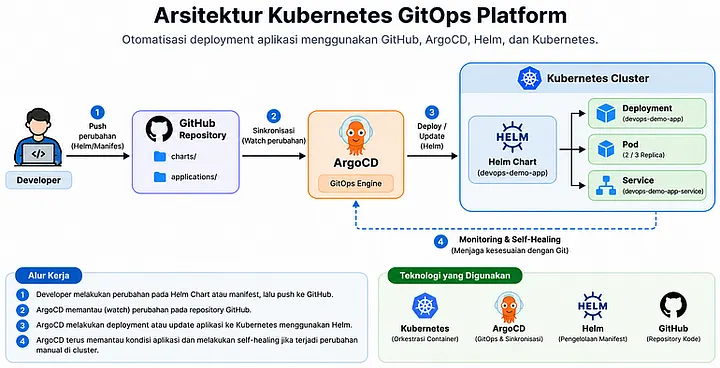
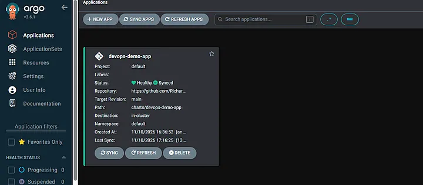
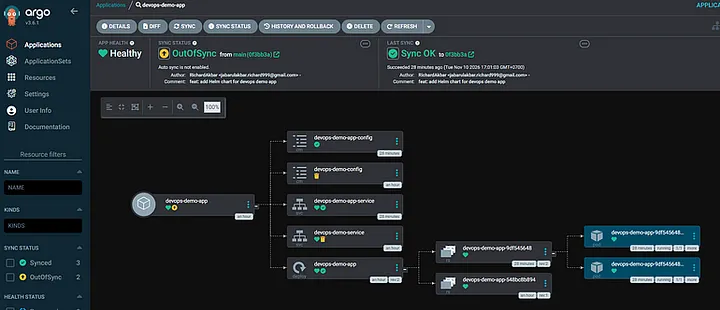
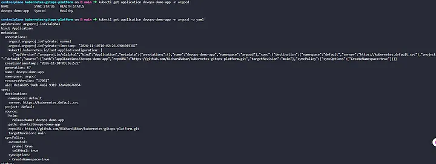

Kubernetes GitOps Platform
Implementasi GitOps pada Kubernetes menggunakan ArgoCD, Helm, dan GitHub untuk mengotomatisasi proses deployment aplikasi, sinkronisasi konfigurasi, pemulihan otomatis, dan rollback.

2. Architecture Diagram

Diagram berikut menggambarkan alur deployment aplikasi menggunakan Kubernetes, Helm, GitHub, dan ArgoCD.

Alur kerja:

Developer melakukan perubahan konfigurasi aplikasi.
Perubahan di-push ke GitHub Repository.
ArgoCD memantau perubahan pada repository.
ArgoCD mengambil konfigurasi Helm Chart.
Kubernetes menjalankan aplikasi sesuai konfigurasi.
ArgoCD melakukan automated sync dan self-healing ketika terjadi perubahan pada cluster.

1. Pemeriksaan Kubernetes Cluster
Tujuan: Memastikan seluruh node Kubernetes berjalan dengan baik dan siap digunakan.

Langkah Pengujian:

Periksa seluruh node Kubernetes:

kubectl get nodes -o wide
Periksa resource aplikasi:

kubectl get deployment,pods,svc,configmap -n default
Hasil yang Diharapkan:

Seluruh node berstatus Ready.
Deployment aplikasi tersedia.
Pod aplikasi berstatus Running.
Service dan ConfigMap berhasil dibuat.
Bukti Screenshot:

C. Pengambilan Screenshot Dashboard ArgoCD
Screenshot 02 — ArgoCD Dashboard

Langkah pengambilan gambar:

Buka Dashboard ArgoCD melalui browser.
Masuk ke halaman Applications.
Cari aplikasi devops-demo-app.
Pastikan status aplikasi menunjukkan Synced dan Healthy.
Ambil screenshot halaman tersebut.
Tempat Screenshot:

Screenshot 03 — ArgoCD Resource Tree

Langkah pengambilan gambar:

Dari halaman Applications, klik aplikasi devops-demo-app.
Buka tampilan Resource Tree.
Pastikan terlihat resource berikut:
Deployment devops-demo-app
Pod aplikasi
Service devops-demo-app-service
ConfigMap devops-demo-app-config

Ambil screenshot tampilan Resource Tree.
Tempat Screenshot:

Hasil Pengujian
ArgoCD berhasil terhubung dengan repository GitHub.
Aplikasi berhasil dideploy ke Kubernetes.
Seluruh resource aplikasi terdeteksi oleh ArgoCD.
Status aplikasi menunjukkan Synced dan Healthy.

1. Deployment Aplikasi Menggunakan ArgoCD
Tujuan: Memastikan ArgoCD berhasil melakukan deployment aplikasi dari repository GitHub.

Langkah Pengujian:

Periksa status aplikasi ArgoCD:

kubectl get application devops-demo-app -n argocd
Periksa konfigurasi aplikasi:

kubectl get application devops-demo-app -n argocd -o yaml
Hasil yang Diharapkan:

Sync Status: Synced
Health Status: Healthy
Repository sumber berasal dari GitHub.
Deployment dikelola oleh ArgoCD.

Bukti Screenshot:

1. Validasi Helm Chart
Tujuan: Memastikan Helm Chart dapat divalidasi dan menghasilkan manifest Kubernetes dengan benar.

Langkah Pengujian:

Periksa Helm Chart:

helm lint charts/devops-demo-app
Tampilkan hasil render manifest:

helm template devops-demo-app charts/devops-demo-app
Periksa struktur Helm Chart:

find charts/devops-demo-app -maxdepth 3 -type f | sort
Hasil yang Diharapkan:

Proses helm lint berhasil.
Helm berhasil menghasilkan manifest.
Manifest Deployment, Service, dan ConfigMap tersedia.

Bukti Screenshot:

1. Pengujian Automated Sync
Tujuan: Memastikan perubahan konfigurasi yang dikirim ke GitHub diterapkan secara otomatis oleh ArgoCD ke Kubernetes.

Langkah Pengujian:

Ubah jumlah replica dari 2 menjadi 3:

sed -i 's/^replicaCount: 2$/replicaCount: 3/' charts/devops-demo-app/values.yaml
Periksa perubahan:

grep '^replicaCount:' charts/devops-demo-app/values.yaml
Simpan dan kirim perubahan ke GitHub:

git add charts/devops-demo-app/values.yaml
git commit -m "test: increase app replicas to 3"
git push origin main
Periksa hasil deployment:

kubectl get deployment devops-demo-app -n default
kubectl get pods -n default
kubectl get application devops-demo-app -n argocd
Hasil yang Diharapkan:

Jumlah replica berubah dari 2 menjadi 3.
Tiga Pod aplikasi berstatus Running.
ArgoCD melakukan sinkronisasi otomatis tanpa menekan tombol Sync secara manual.
Bukti Screenshot:

1. Pengujian Self-Healing
Tujuan: Memastikan ArgoCD dapat memperbaiki perubahan manual pada resource Kubernetes agar kembali sesuai dengan konfigurasi yang tersimpan di GitHub.

Langkah Pengujian:

Ubah image Deployment secara manual:

kubectl set image deployment/devops-demo-app nginx=nginx:99.99-invalid -n default
Tunggu proses rekonsiliasi:

sleep 30
Periksa image Deployment:

kubectl get deployment devops-demo-app -n default \
  -o jsonpath='Image Deployment: {.spec.template.spec.containers[0].image}{"\n"}'
Periksa aktivitas ArgoCD:

kubectl describe application devops-demo-app -n argocd
Hasil yang Diharapkan:

Perubahan image manual terdeteksi.
ArgoCD menjalankan proses Self-Healing.
Image kembali ke nginx:1.27.
Aplikasi kembali berstatus Synced dan Healthy.
Bukti Screenshot:

1. Pengujian Git Rollback
Tujuan: Memastikan perubahan konfigurasi dapat dikembalikan ke versi sebelumnya melalui Git dan diterapkan otomatis oleh ArgoCD.

Langkah Pengujian:

Periksa riwayat commit:

git log --oneline -5
Batalkan commit yang mengubah jumlah replica menjadi 3:

git revert --no-edit 182ec7a
Kirim perubahan rollback ke GitHub:

git push origin main
Minta ArgoCD memeriksa perubahan terbaru:

kubectl patch application devops-demo-app -n argocd \
  --type merge \
  -p '{"metadata":{"annotations":{"argocd.argoproj.io/refresh":"hard"}}}'
Periksa hasil rollback:

kubectl get deployment devops-demo-app -n default
kubectl get pods -n default
kubectl get application devops-demo-app -n argocd
Hasil yang Diharapkan:

Jumlah replica kembali dari 3 menjadi 2.
Dua Pod aplikasi berstatus Running.
ArgoCD menggunakan revision rollback terbaru.
Aplikasi kembali berstatus Synced dan Healthy.
Bukti Screenshot:

1. Hasil Akhir Proyek
Pemeriksaan akhir seluruh komponen:

kubectl get nodes
kubectl get deployment,pods,svc,configmap -n default
kubectl get application devops-demo-app -n argocd
git log --oneline -5

Kesimpulan:

Proyek Kubernetes GitOps Platform telah berhasil menerapkan dan menguji:

Deployment aplikasi pada Kubernetes.
Integrasi ArgoCD dengan repository GitHub.
Pengelolaan manifest menggunakan Helm Chart.
Sinkronisasi otomatis melalui Automated Sync.
Pemulihan konfigurasi melalui Self-Healing.
Pengembalian konfigurasi aplikasi melalui Git Rollback.
Repository GitHub:

https://github.com/RichardAkbar/kubernetes-gitops-platform